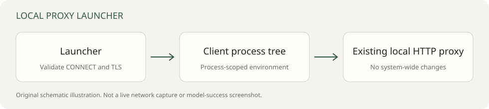

# Local Proxy Launcher

**独立代理启动器** -- 适配 Antigravity 的非官方 Windows 独立进程代理启动工具。

[English](README_EN.md) · [中文离线教程](docs/使用教程.html) · [兼容性](COMPATIBILITY.md) · [安全说明](SECURITY.md)

> v1.0.0-beta.2 公开测试版（Pre-release），本次仅更新维护者账号、链接和发布元数据。不是所有平台、所有 VPN 均兼容的稳定版本。

维护者：[小路卡 XiaoLuka / XiaoLukaLab](https://github.com/XiaoLukaLab) 。[版本发布页](https://github.com/XiaoLukaLab/local-proxy-launcher/releases/tag/v1.0.0-beta.2) 。

## 解决什么问题

浏览器能登录 Google，但 Antigravity 在普通代理模式下反复出现模型加载失败、网络重试或 TLS 握手超时？本工具先验证已有本机 HTTP/Mixed 代理，再用独立进程环境启动官方客户端，让主进程与继承环境的后台进程使用同一代理路径。

不包含 Antigravity 官方客户端，不提供 VPN、账号、额度或地区资格，不绕过服务限制，与 Google 无隶属、赞助或背书关系。

## 下载与三步开始

- [Windows 用户包](https://github.com/XiaoLukaLab/local-proxy-launcher/releases/download/v1.0.0-beta.2/LocalProxyLauncher-v1.0.0-beta.2-Windows.zip)
- [源码包](https://github.com/XiaoLukaLab/local-proxy-launcher/releases/download/v1.0.0-beta.2/LocalProxyLauncher-v1.0.0-beta.2-Source.zip)
- [SHA256 校验值](https://github.com/XiaoLukaLab/local-proxy-launcher/releases/download/v1.0.0-beta.2/SHA256SUMS.txt)

1. **准备：**自行安装并登录 Antigravity，打开已有的本地 HTTP/Mixed 代理；目标是在 VPN 正常开启、TUN 关闭时使用。
2. **部署：**完整解压 Windows ZIP，双击「01 一键部署.bat」。等待明确的成功提示，不要在 ZIP 预览里运行。
3. **启动：**等待客户端任务和更新结束，正常退出旧实例，再双击桌面「独立代理启动器」。查看模型列表并发送真实测试问题。

无需 Codex、编程或新增运行库，通常无需管理员权限。运行文件保存在 `%LOCALAPPDATA%\LocalProxyLauncher`，成功部署后删除原解压目录不影响桌面入口。

## 使用条件与能力

- Windows 10 / 11 为设计目标；实机覆盖仅 Windows 10 x64。
- 已安装的 Antigravity，以及可用的免认证本机 HTTP/Mixed 代理。
- 自动发现系统代理、用户代理变量和实际监听端口，不绑定固定端口或 VPN 品牌。
- 验证 HTTPS CONNECT 和 Google TLS，手动地址通过验证才保存。
- 中文部署、启动、诊断和卸载入口，中文和空格路径支持。
- 旧实例与更新保护、有限超时、重复部署配置保留、固定白名单卸载。

## 工作原理

通过 `ProcessStartInfo` 给**新启动的进程树**设置 `HTTP_PROXY`、`HTTPS_PROXY`、`NO_PROXY`，并使用 Chromium 代理参数。默认不设置 `ALL_PROXY`，保留 localhost、IPv4/IPv6 回环通信。其他已运行的软件不继承这些变量；由客户端新启动的开发工具可能继承代理。

系统代理、DNS、hosts、注册表、证书、防火墙和全局环境变量保持原状。不会修改官方程序、注入、Hook、强退进程或添加开机启动。不会读取或上传 Token、Cookie、密码、VPN 密钥或聊天记录。诊断仅对固定公开域名发无凭据请求，保留 TLS 校验。

## 实际测试范围

| 场景 | 状态 |
|---|---|
| Windows 10 x64，非管理员，已有 MagicHut 代理 | 有真实测试，仍观察到上游偶发超时 |
| 运行层历史检查 | 14/14 通过，包含真实与模拟用例 |
| 部署历史检查 | 6/7 通过；末轮手动代理配置复验为 TLS 超时 |
| 中文/空格路径、重复部署、卸载重装、解压副本删除后目标自检 | 有真实文件与部署测试 |
| Windows 11、其他 VPN、ARM64 | 尚未实机验证 |
| 新版入口的真实模型回复、多轮开发任务 | 尚待最终确认 |

这些数字是本地 V1.0.0 基线证据，不是对改名后的 Beta 或所有网络环境的通过率承诺。完整分层记录见 [QA_SUMMARY.json](QA_SUMMARY.json)、[兼容性说明](COMPATIBILITY.md) 和 [验收记录](FINAL_ACCEPTANCE.md)。

## 常见问题

**VPN 已开启，为什么仍然失败？** 本机监听可用不等于 CONNECT、TLS 或模型服务可用。运行「03 网络故障诊断.bat」，区分传输、认证、权限、额度和服务状态。HTTP 401/403/404 不能一律当作业务成功。

**不知道代理端口？** 先让工具自动检测。失败后从 VPN 设置中查看 HTTP/Mixed 端口，在诊断菜单 2 填写 `127.0.0.1:端口`，菜单 3 可重新发现。只支持 loopback，不支持 SOCKS-only、远程认证和 PAC-only。

**更新或旧实例阻止启动？** 等待任务、官方更新完成，从菜单正常退出含托盘实例。工具不会帮你强退；日志最后仍为下载中时保守停止。

**安全软件阻止脚本？** 包未签名。入口仅给本次 PowerShell 进程指定执行策略，不改用户/系统策略；组策略与应用控制仍可能阻止。不要关闭防护或绕过组织规则。

## 卸载与恢复

双击「04 卸载启动器.bat」，移除本工具运行文件和仍属于它的桌面入口，默认保留独立配置、诊断日志和用户未知文件。官方客户端、登录状态、项目和聊天不删除。正常退出后从原官方入口启动，即恢复原方式，无全局代理需要回滚。

## 开发与许可

[架构](docs/ARCHITECTURE.md) · [维护与构建](docs/MAINTENANCE.md) · [贡献指南](CONTRIBUTING.md) · [版本记录](CHANGELOG.md)

本项目采用 [MIT License](LICENSE)，允许按许可条件使用、修改、分发及商业使用。请保留版权与许可声明；软件按现状提供。

感谢 [mujian0086/antigravity-proxy-launcher](https://github.com/mujian0086/antigravity-proxy-launcher) 提供公开实现原理参考。未执行其远程安装脚本，未捆绑其仓库文件、官方客户端或品牌素材，详见 [第三方说明](THIRD_PARTY_NOTICES.md)。
